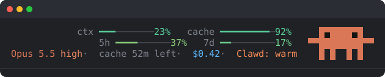
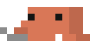
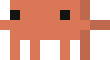
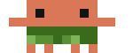

<div align="center">


# cozy-clawd

**Context, cache and limits at a glance, right above the Claude Code prompt.<br>And a little Clawd who keeps your prompt cache warm.**

English · [Русский](README.ru.md)




</div>

## Install

You need [Claude Code](https://docs.claude.com/en/docs/claude-code) 2.1.275 or newer (`claude --version`).

**1. Install.** Inside a Claude Code session, run:

```
/plugin install cozy-clawd --marketplace evrytests-maker/cozy-clawd
```

Or from a terminal:

```bash
claude plugin install cozy-clawd --marketplace evrytests-maker/cozy-clawd
```

**2. Restart Claude Code** (or run `/reload-plugins`). The band shows up above the prompt. Everything ships in the repo, so there's no setup and nothing else to download.

**3. Click Clawd** if you want him to keep the cache warm.

<details>
<summary>Older Claude Code, or the long way</summary>

```
/plugin marketplace add evrytests-maker/cozy-clawd
/plugin install cozy-clawd@cozy-clawd
```

</details>

<details>
<summary>Try it without installing</summary>

```bash
git clone https://github.com/evrytests-maker/cozy-clawd
claude --plugin-dir ./cozy-clawd
```

</details>

<details>
<summary>Update, turn off, remove</summary>

```bash
claude plugin marketplace update cozy-clawd   # fetch the latest version
claude plugin update cozy-clawd@cozy-clawd    # then restart Claude Code
claude plugin disable cozy-clawd@cozy-clawd   # hide the band for now
claude plugin uninstall cozy-clawd@cozy-clawd # remove it
```

</details>

## What's on the band

```
▾ ctx ▃▃▃▃▃▃▃▃▃▃  23%  cache ▃▃▃▃▃▃▃▃▃▃  92%
  5h  ▃▃▃▃▃▃▃▃▃▃  37%  7d    ▃▃▃▃▃▃▃▃▃▃  17%
  Opus 5.5 high · cache 52m left · $0.42 · Σ 1.4M tok · Clawd: warm
```

| Row | What it tells you |
| --- | --- |
| 1 | **ctx**: how full the context is, counted against the auto-compact window. Click the percent to see tokens (`48k/1M`), and click again to go back. **cache**: how much of the last request was read from the prompt cache. |
| 2 | Your **5h** and **7d** subscription limits. Click a percent to see when that limit resets (`3h23m`), and click again to go back. Until a new session gets its first response, the last reading from any session is shown. The row is hidden on an API key. |
| 3 | Model and reasoning effort, how long the prompt cache has left (one hour on a subscription), spend so far, every token the chat used (`Σ`; click it for input, output and cache), and `Clawd: warm` while he watches the cache. `▾` folds the band into one `▸ Clawd` line (with the limit nearest to full, the spend and the cache hit), kept across sessions. |

The bars go green → amber → red as they fill (the cache bar runs the other way). Values ease into place, and a shine runs along the bars while Claude is working.

## Meet Clawd


Clawd sits to the right of the bars and reacts to what your session is doing.

| | When | What he does |
| --- | --- | --- |
|  | Claude is answering | types away on a laptop: calm clicks, then faster, and flat out he strikes the keys from over his head |
|  | answer done, ≥ 80% from cache | dances, hearts float up |
|  | a tool call failed | facepalm |
|  | `/compact` or auto-compact | a press packs pages of context into a tiny cube |
|  | warming the cache | sits by a campfire, warms his hands, tosses a log in now and then |
|  | the cache expired | meditates under drifting `z`s |
|  | nothing going on | looks around, waves, crab-walks, does the hula… |

All 32 of his animations, and when each plays: [animations/](animations/).

## Keep the cache warm


On a subscription the prompt cache lives for an hour. Come back later and the next message re-reads the whole context at full price.

**Click Clawd** to let him watch it. Five minutes before the cache runs out he replays the session's last request with a one-character reply. That counts as a cache read, so the hour starts again. He does this at most 3 times in a row (about 4 hours away from the keyboard), then lets it go. Click him again to stop.

While he watches, Clawd sits by the campfire the whole time: he warms his hands and every few seconds tosses a log in, and the flame flares up. He only leaves it to type on the laptop while Claude answers. Click him again and the fire goes out.

Each warm-up costs a small cache read against your limits. On an API key the cache lives 5 minutes, so you won't need it there.

## Good to know

- The empty row between the band and the prompt line belongs to Claude Code (it holds notices like `● high · /effort`). A plugin can't draw there.
- The cache numbers follow the main conversation. Subagents keep caches of their own.
- If the older `session-meter` plugin is enabled too, it draws the band instead.
- In the Claude desktop app Clawd is drawn as a picture, which can't be clicked. The cache watch is the `Clawd: off` / `Clawd: warm` button at the end of the third row there.

## Development



```bash
git clone https://github.com/evrytests-maker/cozy-clawd
claude --plugin-dir ./cozy-clawd       # try it in a session
claude plugin validate ./cozy-clawd
claude plugin test ./cozy-clawd
```

| Path | What's there |
| --- | --- |
| `hooks/register.tsx` | the band, the cache watch, the animation loop |
| `hooks/clawd.ts` | which animation plays when, hearts, the half-block drawing |
| `hooks/clawd-anims.ts` | every frame, generated |
| `tools/extract_sprites.py` | reads the source sprite sheets into `sprites.json` |
| `tools/gen_anims.py` | builds `clawd-anims.ts`; the press is drawn in here, the campfire comes from `tools/campfire/` |
| `tools/gen_svgs.py` | builds the pictures in `assets/` from the frames |

After changing animations:

```bash
python3 tools/gen_anims.py sprites.json hooks/clawd-anims.ts
python3 tools/gen_svgs.py hooks/clawd-anims.ts assets
```

## License

[MIT](LICENSE)

<div align="center"></div>
