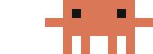
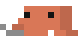
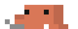
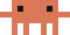
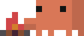
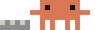
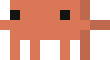
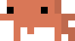
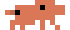

# Clawd's animations

Every clip Clawd plays on the band, frame by frame as the band draws them. Hearts, sparks and other glyphs drawn over him are left out.

## While Claude answers

| | Clip | When |
|---|---|---|
|  | `laptop` | sets down the laptop |
|  | `type0` | types, the slowest: under 15 characters a second |
|  | `type1` | types faster: 15 to 100 a second |
|  | `type2` | faster still: 100 to 250 a second, a swing and then two hard clicks, 2 and 3 pixels up |
|  | `type3` | flat out: over 250 a second, keys clicking |
|  | `laptopOut` | packs the laptop away when the answer is done |

## When an answer is done

| | Clip | When |
|---|---|---|
|  | `dance` | 80% or more from the cache, with hearts |
|  | `excited` | 50 to 80% from the cache, or no reading yet |
|  | `disappointed` | under 50% from the cache |
|  | `facepalm` | a tool call failed |

## Moods

| | Clip | When |
|---|---|---|
|  | `meditate` | the cache expired: meditates under drifting z's |
|  | `dizzy` | context or the 5h limit at 85% or more, sweating |

## Warm mode

| | Clip | When |
|---|---|---|
|  | `campfire` | sits down and lights a fire |
|  | `campfireSit` | warms his hands, sparks rise |
|  | `campfireLog` | tosses a log in now and then |
|  | `campfireOut` | the fire dies down, he stands up |

## Compaction

| | Clip | When |
|---|---|---|
|  | `compact` | sheets of context drop onto a pile, a press packs them |
|  | `compactOut` | a little cube is left, Clawd hops |

## Idle, one at random every 5 to 13 seconds

| | Clip | When |
|---|---|---|
|  | `idle` | stands |
|  | `lookAround` | looks around |
|  | `eyes` | glances about |
|  | `sway` | sways |
|  | `turning` | turns around |
|  | `wave` | waves |
|  | `hula` | dances the hula |
|  | `crab` | crab-walks |
|  | `walk` | walks |
|  | `run` | runs on the spot |
|  | `point` | points |
|  | `breakdance` | breakdances |
|  | `spark` | sparkles |
|  | `jump` | jumps |

Drawn by `python3 -I tools/gen_svgs.py hooks/clawd-anims.ts assets animations`.
